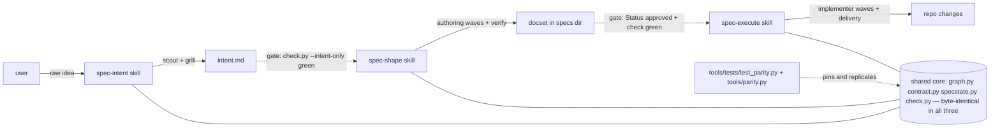

# Tech Spec: spec-to-prod-split

**Spec**: [spec.md](spec.md) | **Created**: 2026-10-10
**Every file/symbol citation below must come verbatim from [survey.md](survey.md)
or a grep run in this session — never from memory.**

## Architecture

Today one monolithic skill owns all three concerns. The survey proves the
monolith is fully live and nothing of the trio exists: `skills/` holds
"spec-brainstorming spec-code-review spec-to-prod" (survey FR-001), the
engine and its contract table live only in spec-to-prod's `scripts/`
("graph.py specstate.py contract.py telemetry.py check.py …", survey
FR-005), and the approve gate is a mid-graph node — `graph.py:147`
`APPROVED_AND_LATER`, `graph.py:1368–:1383` — not an invocation-time gate
(survey FR-004 gap). The split keeps that engine as the only executable
form (survey NFR-001: D-035 deleted the dialects; `graph.py:69` `--run` is
the one engine) and gives each phase a skill that runs a bounded window of
the same graph, with an invocation-time intake gate at each seam:

One shared core, three windows, two mechanical gates. The doc state under
`specs/` stays the only state; intent.md joins it as a checked input
artifact, and every gate is a mechanical refusal (nonzero exit naming the
blocking gate), never prose.

## Solution

### Chosen approach

**1. intent.md is a check.py profile (FR-001, FR-002).** The intent
artifact is a new template (`templates/intent.md` does not exist today —
survey FR-001 gap) validated by a new `check.py` `--intent-only` mode
(taking the spec dir, like `--survey-only`), a sibling of the existing
`--survey-only` mode
(check.py's mode family, survey FR-002 evidence context). The profile
reuses the three refusal families that already exist for the docset
(survey FR-002): unfilled-template/placeholder refusal (check.py:612
"spec.md is unfilled or carries template placeholders"), open clarify
markers (check.py:1013), and baseline staleness vs the repo's HEAD
(check.py:1116, diagnosis branches :1126–:1203). The artifact carries the
same `**Baseline**:` header shape survey.md uses, so the staleness
diagnosis reads it unchanged. `--intent-only` exits nonzero naming every
failure (US1-AC2). In the full docset check, intent.md is an optional
input: absent → not checked; present → the intent checks run and FAIL on
a red artifact. This is the spec's own assumption made mechanical: "a
profile of the existing check discipline, not a second ungated format".

**2. An intent node in the one contract table (FR-003, FR-008).**
`contract.py`'s NODE_TABLE (survey FR-003 evidence: its rows; the first
row today is the `spec` entry node) gains an `intent` row — kind agent,
ready when spec.md is done and intent.md is missing/unfilled/failing,
done when "intent.md filled AND `check.py <spec-dir> --intent-only`
exits 0". `NODES`/`DATA_EDGES` in graph.py gain `intent` and the edges
`spec → intent → survey` (survey supporting evidence: graph.py:178 names
contract.py the single source; graph.py:156/:157 edge rows). The brief
map gains `intent → (surveyor, scout.md, intent lens)` — both ingredients
pre-exist (survey FR-001: `agents/scout.md`, `agents/_lenses.md`, and
the grilling primitive `references/grilling.md:1/:3`).
FR-003 ↔ FR-008 reconciliation: intent.md **absent** reads as the legacy
path — the node records SKIPPED citing FR-008, and shape proceeds,
because the docset contract is unchanged and shape/execute must accept
any dir satisfying it (survey FR-008: check.py is contract-shaped, not
provenance-shaped — nothing keys on which skill authored the dir).
intent.md **present but red** is the ungated artifact US2-AC2 names:
the node is BLOCKED and shape's intake gate refuses.

**3. Phase spans over the unchanged graph (FR-003, FR-004).** graph.py
gains `--span intent|shape|execute|full` (valid with `--run` and
`--emit-spawns`): a span is a window over the same NODE_TABLE — intent:
spec, clarify, intent; shape: research-gate, research, survey, plan,
tech, qa, tasks, verify; execute: execute, tick-commit, archive; full
(the default): everything, preserving today's bare-invocation semantics
for existing dirs (FR-008). Spans change which frontier nodes may run —
never the node conditions. Two invocation-time gates, both implemented
as one span-entry check on already-computed node states (no second
validation path): `--span shape` refuses when the intent node is BLOCKED
(present-but-red intent); `--span execute` refuses unless approve is
DONE (`Status: approved` or later — survey FR-004: `graph.py:147`,
`:1371`) **and** verify is DONE (check.py exit 0 — the verify node
already computes it, survey FR-004 evidence `graph.py:83`). Refusals
print the blocking gate and its reason and exit 4 (0/1/2/3 are taken —
graph.py's documented exits). A span that runs its window dry stops with
a named handoff ("approve gate reached — approve, then /spec-execute"),
so shape structurally cannot run implementation waves.

**4. Parity pipeline for the shared core (FR-005, NFR-001, NFR-003).**
The parity set is the FR-005 core — graph.py, contract.py, specstate.py,
check.py — plus telemetry.py (already pinned by the kit suite, survey
FR-005/NFR-003 evidence) and any sibling module the set imports at load
time; the parity test enumerates that closure mechanically so the pin
cannot miss a dependency. The canonical master lives in
`skills/spec-shape/scripts/`; a new stdlib-only `tools/parity.py`
replicates the closure into spec-intent and spec-execute (committed,
regenerate-only views — the root `agents/` personas precedent). A new
kit suite `tools/tests/test_parity.py` auto-discovers skills shipping
graph.py and asserts one sha per file across them — the exact
test_telemetry.py pattern (survey FR-005: `:38–:41`
`test_modules_are_byte_identical`; auto-discovery `:20–:21` "joins the
pin by existing"). Keying discovery on graph.py auto-scopes the pin to
the trio: spec-brainstorming ships a check.py but no graph.py (survey
FR-005 scripts listings), so its own checker is never falsely compared.
`tools/sync.sh` refreshes the replicas before every install in the same
slot it already refreshes the kit-rules carriers (survey supporting
evidence: kit-rules injection runs before install), and drift-check
grows rows pinning the replicas to the master.

**5. Install topology unchanged; claims move (FR-006, FR-010).**
sync.sh is skill-count-agnostic — "a skill opts into this topology just
by existing at `skills/<name>/` with a SKILL.md" (survey FR-006 evidence
:92–:93), all roots including Kilo's native skills root (survey FR-006:
D-040, sync.sh:57–:59/:148). The three skills install by existing; no
topology edit. Bare command names move per each skill's
`commands/extra.txt` opt-in (survey supporting evidence :152–:160):
spec-intent claims `spec` (today's intake verb — the router's verb list,
survey FR-010); spec-execute claims `spec-plan`, `spec-build`,
`spec-test`, `spec-review`, `spec-ship` (they exist to move — survey
FR-010 commands listing); spec-shape hosts the one-release thin
`/spec-to-prod` alias router (FR-010) via its extra.txt.

**6. Per-skill telemetry (FR-007).** The engine already records
`gate_pause`/`run_end`/`wave` but under a hardcoded skill literal —
`_record("spec-to-prod", …)` at graph.py:1097/:1103/:1112 (survey
FR-007). The literal is replaced by the engine's own resolved skill root
name (the same root every payload already carries as `skill_dir`), so
the byte-identical file records under spec-intent/spec-shape/spec-execute
as each copy runs — no per-skill branch. The two new gate refusals are
chokepoints too: a refusal records an `intake_refusal` event under the
refusing skill. The scheme itself is untouched: JSONL per skill under
`~/.spec-dev-kit/telemetry/` (survey FR-007: telemetry.py:6/:55), which
is also the spec's 30-day tripwire substrate.

**7. Same-release retirement with a sweep (FR-009).** Deleting
`skills/spec-to-prod/` removes it from sync.sh's SKILLS discovery, so
its flat command deploys become stale and are pruned by the existing
ledger discipline — but its installed **skill trees** at the roots are
not swept by anything today (the sweep runs per surviving skill). sync.sh
therefore grows a retired-skills stanza: a committed
`tools/retired-skills.txt` naming `spec-to-prod`; for each name, the
skill trees at every root (including Kilo native) are swept with no
master — deleting only files the provenance ledger proves were this
kit's deploys, refusing anything foreign (the same
refuse-don't-clobber rule the trees already follow, survey FR-006
substrate context). Regenerate-only surfaces refresh in the same release:
marketplace.json via tools/plugin-manifest.py (survey FR-009: its
`"name": "spec-to-prod"` / `"source": "./skills/spec-to-prod"` rows are
a generate-only surface), the root `agents/` personas (regenerated from
surviving skills' briefs), and the kit-rules carriers (the
§ Engineering rules section moves from spec-to-prod's
`agents/_shared-protocol.md` to the three successors). One retirement
ADR records the removal (survey FR-009 gap: 39 decision files, none a
retirement); existing dirs keep working per FR-008.

**FR coverage map**: FR-001 → items 1–2 (scout/grill ingredients +
intent node); FR-002 → item 1 (`--intent-only` refusal families);
FR-003 → items 2–3 (intent node + shape span gate); FR-004 → item 3
(execute span gate on approve+verify); FR-005 → item 4; FR-006 → item 5;
FR-007 → item 6; FR-008 → items 2–3 (legacy-absent path, default span
full); FR-009 → item 7; FR-010 → item 5 (command claims + alias).

### Alternatives rejected

| Alternative | Why rejected |
|-------------|--------------|
| Kit-level shared core outside the skills (all three import one copy; no duplication) | Breaks self-contained packaging — each `skills/<name>/` ships alone as a marketplace source (survey FR-005: the kit's "self-contained-packaging duplication" is deliberate, pinned like telemetry.py; survey FR-009: marketplace `source: ./skills/<name>` rows) |
| Generate the trio's core copies at install time instead of committing them | Marketplace/plugin installs read `skills/<name>/` alone — sync.sh is not in the shipped surface (survey FR-006: sync installs from the repo's master source; FR-009 marketplace rows) |
| Three per-skill node tables / phase engines | Recreates the retired-dialect failure mode D-035 deleted — survey NFR-001 evidence: "delete the dialects … `graph.py --run` is the one engine on every harness"; NFR-001 forbids a fork |
| A second intent-checker script owned by spec-intent | Spec assumption: intent is "a profile of the existing check discipline, not a second ungated format"; all three refusal families already exist in check.py (survey FR-002) — a second checker is a fork of the discipline |
| Gates as SKILL.md prose instructions (no engine exit) | Unmechanical — US2-AC2/US3-AC2 demand a loud refusal; today's gap is exactly that approval is "a mid-graph blocked node, not an invocation-time gate" (survey FR-004 gap) |
| Keep spec-to-prod installed for a coexistence window | Contradicts the resolved clarify round — same-release retirement, no coexistence (spec Assumptions; FR-009) |
| Neutral fourth master location (e.g. a tools/ core dir) for the parity source | No installer reads it — sync installs `skills/<name>/` only (survey FR-006 evidence :92–:93); it adds an orphan surface instead of one of the shipped copies being canonical |

## Impact analysis

Blast radius of splitting spec-to-prod. The decision flips a shipped-set
default (three skills replace one), so the test tree was swept for pins
on that set and its names; classes per the design spine (flag pins /
exact-count pins / exact-traffic pins / behavior pins).

| Surface | Impact | Evidence |
|---------|--------|----------|
| `tools/sync.sh` | No topology change for install (opt-in by existing). New: pre-install parity refresh slot; retired-skills sweep stanza | survey FR-006 :92–:93; supporting evidence kit-rules pre-install refresh |
| Def generators (`tools/agent-defs.py`, `tools/omp-defs.py`) | Zero behavioral change — both are skill-agnostic and pick up new skills' `agents/` automatically | survey supporting evidence: agent-defs.py:3, omp-defs.py:6 "adding a second skill's roles needs no edit here" |
| `tools/tests/test_telemetry.py` | Parity pattern extends; exact-set pin must be rewritten for the new skill set | survey FR-005 :38–:41 pattern; :20–:21 auto-discovery |
| Commands | spec-to-prod.md router + 7 bare names (survey FR-010 listing) redistribute: `spec` → spec-intent, 5 lifecycle verbs → spec-execute, alias router one release in spec-shape | survey FR-010 |
| Evals | `skills/spec-to-prod/evals/cases.md` E1–E6 (survey supporting evidence :17–:80) retire with the skill; no eval case names the trio today — the split adds per-skill cases and moves existing ones by phase | survey supporting evidence |
| `tools/drift-check.py` | Canonical-path updates (SKILL/diagram/fixture point at spec-to-prod today) + new parity rows | survey supporting evidence: drift-check pins contract render + diagrams + examples fixture |
| Kit-rules carriers | § Engineering rules carrier moves from spec-to-prod's `_shared-protocol.md` to the successors | survey supporting evidence kit-rules.py:3 canonical-once, injected into carriers |
| Root `agents/` personas | Regenerate from surviving skills; spec-to-prod's personas must not linger | survey FR-009 evidence: agents install per roots sync.sh:34 |

Test-tree sweep for the flipped skill-set default — every test in the
first three classes, by file and name (session-verified reads; survey
cites the suites' green runs, not these specific assertions — flagged as
a survey gap in the digest reply):

- **Flag pins (exact name/set assertions that flip)**:
  `tools/tests/test_telemetry.py` `ParityTests.test_all_three_skills_ship_the_module`
  (asserts the exact list spec-brainstorming/spec-code-review/spec-to-prod);
  `tools/tests/test_sync.py` `DroidCommandsTests.test_commands_install_when_factory_home_exists`
  and `KiloCommandsTests.test_commands_and_defs_install_when_kilo_home_exists`
  (assert the exact command set `spec, spec-plan, spec-build, spec-test,
  spec-review, spec-ship, spec-to-prod` and a `scout.md` def);
  `tools/tests/test_evals.py`
  `LoadCasesTests.test_discovers_every_conversational_case`
  (asserts selector `spec-to-prod/e6`).
- **Exact-count pins**: `tools/tests/test_evals.py`
  `LoadCasesTests.test_discovers_every_conversational_case` also pins the
  corpus at 17 cases — moving E1–E6 by phase changes the count.
- **Exact-traffic pins**: none found — no test pins the engine's
  telemetry skill literal traffic; `tools/grade.py`
  `skill_dogfood_targets`/`skill_dogfood` pin the known-skill triple and
  spec-to-prod's checker/fixture paths (a mapping, not traffic).
- **Behavior pins (must stay green)**: sync.sh discovery/ledger/refuse
  behavior (`tools/tests/test_sync.py`, 32 tests — survey FR-006 verify);
  def generation over real briefs (`tools/tests/test_agent_defs.py`,
  `tools/tests/test_omp_defs.py`); kit-rules injection
  (`tools/tests/test_kit_rules.py`); drift surfaces
  (`tools/tests/test_drift_check.py`); the engine suites (survey NFR-003:
  12/10/23 tests OK across the three skills).

Biggest symbol: `skills/spec-to-prod/scripts/graph.py` (the 14-node
engine + contract import). Direct callers: **5** — the engine test
suite `skills/spec-to-prod/tests/test_graph.py`, the thin-floor suite
`test_thin_floor.py` (both session-verified invokers; green runs pinned
by survey FR-003/NFR-003), `tools/drift-check.py` (loads NODES/edge
tables — survey supporting evidence), the command router
`commands/spec-to-prod.md` (survey FR-010), and SKILL.md's workflow
invocations (survey FR-004 cites SKILL.md:616/:618/:693). Resolution
caveat: "spec-to-prod" is a common name — precise here is the skill
directory and its scripts; fuzzy near-matches that are NOT callers: the
telemetry skill-name literals at graph.py:1097/:1103/:1112 (string
argument, becomes derived), the marketplace name field (survey FR-009
:35), and grade.py's known-skill list (session-verified).

## Quality, threats, and rollback

| Requirement | Design consequence / threat mitigation | Rollback or verification |
|-------------|----------------------------------------|--------------------------|
| NFR-001 (no dialect/engine fork) | Spans are windows over one NODE_TABLE; the byte-identity pin (item 4) fails any suite run with diverged copies; per D-035 the workflow dialects stay deleted (survey NFR-001: workflows/ absent on disk) | `python3 tools/tests/test_parity.py` + `python3 tools/drift-check.py`; rollback = revert the release commit — one engine, no migration |
| NFR-002 (one ADR per surface + retirement ADR) | The split ships kit ADRs per affected surface: intent profile, intent node/spans, parity pipeline, telemetry naming, command claims/alias, retirement (FR-009); append-only per C-05 (survey NFR-002 evidence: CONSTITUTION.md:20) | Each surface's task names its ADR; check.py's D-structure checks keep them well-formed |
| NFR-003 (own suite per skill + kit parity suite) | Three new `tests/run.sh` suites (the discipline: every skill ships one — survey NFR-003 evidence, three suites listed) + `tools/tests/test_parity.py` failing on any copy divergence; all green at every task tick (C-07) | `bash skills/spec-intent/tests/run.sh` (new) ×3 + `python3 tools/tests/run.sh` |

Threat model (compact): the privileged operation is sync.sh writing to
home-directory harness roots — mitigated by the existing
provenance-ledger refuse-don't-clobber discipline and never fabricating
harness dirs (survey FR-006 substrate evidence; D-040 optional-root
gating). The persistence surfaces are telemetry JSONL (fire-and-forget,
off-switch — survey FR-007 verify) and install ledgers. External input
is limited to repo-local, LLM-authored markdown artifacts; the intent
gate's baseline-mismatch refusal (item 1) is exactly the control against
a stale artifact flowing into shape. No auth, no secrets, no network.
Migration: none — FR-008 keeps every on-disk spec dir valid; the
docset contract files are unchanged (survey FR-008: the mini-spec
fixture passes today's checker untouched). Residual risks: (a) an
intent.md green at shape-time can go stale while shape runs — accepted,
the same staleness class survey.md already has, re-caught by shape's
verify; (b) one-release alias router can mis-route a verb — mitigated
by keeping the alias a thin forwarder over the three new commands only.
Rollback strategy: the split lands as one release; reverting the release
commit + `bash tools/sync.sh` reinstalls the monolith, and the ledger
discipline prunes the trio's stale deploys (the stale-command prune
already exists; the retired-skills sweep covers trees symmetrically in
either direction).

## Code guide

### Shared core (engine + contract + check profile)
- Touches: the NODE_TABLE rows and `graph.py:156–:157` edge rows (survey
  FR-003); `graph.py:147` `APPROVED_AND_LATER` and the approve node
  block `graph.py:1366–:1383` (survey FR-004); the check refusal
  families at check.py:612/:1013/:1069/:1116/:1126–:1203 (survey FR-002)
- Approach: master copy in `skills/spec-shape/scripts/` — add the
  intent node + edges + `--span` + gate-refusal exit 4 +
  `--intent-only` profile + derived telemetry skill name (items 1–3, 6);
  regenerate SKILL.md node tables ×3 via the existing render (survey
  supporting evidence: contract.py:8–:10 + drift-check pin)
- Verify before implementing: `bash skills/spec-to-prod/tests/run.sh`
  (today's engine suite, survey FR-003 verify) — then the same command
  under `skills/spec-shape/` once the split lands
- Pitfalls: never edit a replica (regenerate-only views); `--span`
  must not change any node's ready/done vocabulary (CROSS-001 compares
  SKILL.md's table — survey supporting evidence graph.py:127); keep
  default span `full` so existing dirs behave identically (FR-008)

### Kit parity machinery
- Touches: new `tools/parity.py` + `tools/tests/test_parity.py`; the
  sync.sh pre-install refresh slot beside the kit-rules refresh (survey
  supporting evidence); drift-check rows
- Approach: replicator copies the closure master→replicas; parity test
  auto-discovers graph.py-shipping skills, one sha per file (the
  test_telemetry.py:38–:41 pattern, survey FR-005); closure enumerated
  by import scan, not a hand list
- Verify before implementing: `python3 tools/tests/run.sh` (suite home
  of test_telemetry.py, survey FR-005 verify) + `python3 tools/drift-check.py`
- Pitfalls: keying discovery on graph.py (not check.py) is what keeps
  spec-brainstorming's own check.py out of the pin (survey FR-005
  scripts listings); stdlib only (C-06)

### skills/spec-intent/
- Touches: new skill dir; ingredients move from spec-to-prod —
  `agents/scout.md`, `agents/_lenses.md`, the grilling primitive
  `references/grilling.md:1/:3` (survey FR-001); new
  `templates/intent.md` (no template exists today — survey FR-001 gap)
- Approach: SKILL.md (description within the 1024-char loader rule —
  spec assumption), commands `spec-intent.md` + extra.txt `spec`, its
  span is `--span intent`; own `tests/run.sh` (NFR-003)
- Verify before implementing: `bash skills/spec-intent/tests/run.sh`
  (new suite; must exist before its tasks tick)
- Pitfalls: the intent lens section must exist in this skill's
  `_lenses.md` before the intent node can emit payloads; grilling
  markers use the checker's existing open-marker vocabulary so the
  checker's existing marker scan reads them (survey FR-002 check.py:1013)

### skills/spec-shape/
- Touches: new skill dir; absorbs the authoring half — designer/qa brief
  wave, docset templates, the mini-spec example fixture (survey FR-008
  verify command names its path), and the canonical shared-core master
- Approach: commands `spec-shape.md` + the one-release alias
  `spec-to-prod.md` + extra.txt `spec-to-prod`; runs `--span shape`;
  kit-rules carrier moves here (survey supporting evidence kit-rules.py:3)
- Verify before implementing: `python3 skills/spec-to-prod/scripts/check.py
  skills/spec-to-prod/examples/mini-spec/specs/mini-spec` (survey FR-008
  verify — must keep passing from its new home)
- Pitfalls: the fixture's path is baked into kit commands and tests
  (AGENTS.md docset-contract row, drift-check, grade/dogfood paths —
  session-verified) — move it and every reference in the same task

### skills/spec-execute/
- Touches: new skill dir; absorbs the execution half — implementer/
  reviewer briefs, tick/delivery machinery (`scripts/tick.py:3` tick
  shape, survey FR-004), the five lifecycle commands (survey FR-010
  listing) + extra.txt claims, execute-only scripts move single-copy
- Approach: runs `--span execute`; the invocation gate keys on Status
  word + verify green only, so hand-authored approved dirs execute
  identically (US4-AC1); evals E4–E6-class cases move here (survey
  supporting evidence headers)
- Verify before implementing: `bash skills/spec-execute/tests/run.sh`
  (new suite)
- Pitfalls: do not require an approvals/freeze record at the gate — US4
  demands a plain `Status: approved` + green check is enough

### Telemetry per skill
- Touches: the three `_record` literals graph.py:1097/:1103/:1112
  (survey FR-007); telemetry.py itself is untouched (already
  parameterized — telemetry.py:55 `def record(skill: str, …)`)
- Approach: derive the skill name from the engine's resolved skill root
  (the payload `skill_dir` resolution); add `intake_refusal` events at
  the two new gates
- Verify before implementing: `python3 tools/tests/test_telemetry.py`
  (survey FR-007 verify: behavior + off-switch + fire-and-forget)
- Pitfalls: never a per-skill conditional — one derived name keeps the
  file byte-identical (FR-005)

### Retirement + kit surfaces
- Touches: delete `skills/spec-to-prod/` (its sync rows are implicit —
  survey FR-009; marketplace rows :35/:41 regenerate via
  tools/plugin-manifest.py); sync.sh retired-skills stanza; kit-rules
  carriers; drift-check/grade/dogfood path pins; the flag-pin tests
  named in § Impact analysis; AGENTS.md command rows; one retirement ADR
- Approach: same-release cutover (spec Assumptions); retired-skills
  sweep deletes only ledger-proven deploys; regenerate every
  generate-only surface in the same task
- Verify before implementing: `bash tools/sync.sh && bash tools/sync.sh
  --check` (survey FR-006 verify pattern) + `python3 tools/drift-check.py`
- Pitfalls: the skill trees at the roots are NOT pruned by merely
  deleting the master (sweep runs per surviving skill) — without the
  retired-skills stanza the monolith lingers installed, violating FR-009

### Eval corpus
- Touches: `skills/spec-to-prod/evals/cases.md` E1–E6 (survey supporting
  evidence :17–:80) splits by phase into the three skills' evals dirs;
  new cases name spec-intent/spec-shape/spec-execute (survey: none do
  today)
- Approach: every increment names its served eval case (C-10); the
  exact-count and selector pins in test_evals.py update with the move
- Verify before implementing: `python3 tools/tests/test_evals.py`
- Pitfalls: selectors are skill-prefixed (`spec-to-prod/e6` pin,
  session-verified) — renaming skills in selectors without moving case
  bodies breaks the count pin

## References

research.md records "not applicable — no open questions at Stage 0" —
no research findings exist to cite; every rejected alternative above
traces to a survey constraint or a spec-resolved assumption, per the
tech lens contract. Internal anchors: the D-035 one-engine decision and
D-040 Kilo root (survey NFR-001/FR-006 evidence), the brainstorm's kill
criteria in `brainstorms/spec-to-prod-split.md` (survey NFR-002 gap
notes it as untracked input, not an ADR).

## Decisions

### D-001: intent.md is a check.py profile, not a second checker
- **Context**: FR-002's three refusal families already exist in check.py
  for the docset (survey FR-002 evidence); the spec assumption forbids a
  second ungated format.
- **Decision**: new `check.py --intent-only` mode validating the intent
  artifact alone (placeholders, clarify markers, baseline-vs-HEAD); the
  artifact reuses survey.md's baseline header shape; intent.md is an
  optional input in the full docset check — checked when present.
- **Consequences**: one check discipline ships in the parity set; an
  intent-specific validation desire later lands as another profile of
  the same file, never a sibling script.

### D-002: intent-absent is the legacy path, intent-red is the refusal
- **Context**: FR-003 (shape refuses without passing intent) and FR-008
  (existing dirs stay valid; the docset contract is unchanged) pull in
  opposite directions for dirs that predate intent.md.
- **Decision**: the intent node reads SKIPPED when intent.md is absent
  (reason names FR-008) and BLOCKED when present-but-failing; shape's
  span gate refuses only on BLOCKED.
- **Consequences**: hand-authored and legacy dirs shape and execute
  unchanged; the ungated artifact of US2-AC2 is precisely the
  present-but-red one; a stale-but-green intent is re-caught by shape's
  verify, the same staleness class survey.md already carries.

### D-003: phase spans as windows, gates as span-entry refusals
- **Context**: the skills must share one engine (NFR-001) yet each owns
  a phase with an invocation-time gate (FR-003/FR-004; survey FR-004
  gap: today's approval gate is mid-graph, not invocation-time).
- **Decision**: `--span intent|shape|execute|full` (default full) bounds
  the frontier a run may touch; span-entry gate checks already-computed
  node states (intent for shape; approve+verify for execute) and exits 4
  naming the blocking gate; default full preserves bare-invocation
  semantics for existing dirs.
- **Consequences**: no node condition forks per skill; gate logic lives
  once beside the states it reads; exit 4 joins the documented exits;
  shape structurally stops at the approve handoff.

### D-004: parity pipeline — master in spec-shape, replicator, kit pin
- **Context**: FR-005 demands byte-identical core copies across three
  skills; telemetry.py proves the pin pattern but has no replicator, and
  the core churns far more than telemetry does.
- **Decision**: canonical master in `skills/spec-shape/scripts/`;
  `tools/parity.py` regenerates the replicas (committed,
  regenerate-only); `tools/tests/test_parity.py` auto-discovers
  graph.py-shipping skills and asserts one sha per closure file;
  sync.sh refreshes replicas before every install; drift-check pins the
  views.
- **Consequences**: editing a replica is always wrong (regenerate from
  the master); the pin's scope is the trio by construction; a core edit
  costs one master edit plus a regeneration, never three manual copies.

### D-005: per-skill telemetry by derivation, not branch
- **Context**: FR-007 needs events under each skill's own name; the
  engine hardcodes the literal at graph.py:1097/:1103/:1112 (survey
  FR-007) and the file must stay byte-identical (FR-005).
- **Decision**: replace the literal with the engine's own resolved skill
  root name; record `intake_refusal` at the two new gates.
- **Consequences**: the same bytes record under different names per
  installing skill; the 30-day solo-phase tripwire reads per-skill JSONL
  files with no scheme change.

### D-006: command claims and the one-release alias host
- **Context**: bare names land in shared global roots only via each
  skill's extra.txt opt-in (survey supporting evidence :152–:160); the
  router must forward for exactly one release (FR-010).
- **Decision**: spec-intent claims `spec`; spec-execute claims the five
  lifecycle verbs; spec-shape hosts the thin `/spec-to-prod` alias via
  its extra.txt and drops it next release (recorded against the
  retirement ADR family, append-only per NFR-002).
- **Consequences**: no bare-name collisions (a second claimant is
  refused by the existing rule); the router's retirement is a one-line
  extra.txt removal plus command deletion.

### D-007: retired-skills sweep for the monolith's installed surfaces
- **Context**: deleting the master removes spec-to-prod from sync.sh's
  discovery, but nothing today sweeps installed skill trees for a skill
  that no longer ships; FR-009 requires full removal in the same
  release.
- **Decision**: a committed `tools/retired-skills.txt` drives a no-master
  sweep of every root (ledger-proven deploys deleted, foreign files
  refused) plus regeneration of every generate-only surface (marketplace
  manifest, root personas, kit-rules carriers) and the stale-command
  prune that already exists.
- **Consequences**: retirement is idempotent and safe on foreign files;
  re-adding a name to the retired list is the kit's mechanism for any
  future skill retirement; the sweep is symmetric — reverting the
  release re-installs the monolith cleanly.

### D-008: deliberate triplication of a large engine — kept, with eyes open
- **Context**: design screen says subtract before add; the split instead
  triples a ~1700-line engine across skills. That is a red flag kept on
  purpose: self-contained packaging is a kit rule (survey FR-005
  evidence: the duplication is deliberate and pinned), and the
  alternative — one shared import path — breaks marketplace shipping
  (survey FR-009 marketplace source rows).
- **Decision**: keep the triplicated core, bound its cost mechanically
  (D-004 replicator + kit pin + drift rows + per-suite runs at every
  tick per NFR-003).
- **Consequences**: any core change must regenerate and re-verify three
  copies before a tick; the parity suite grows suite time; in exchange,
  each skill installs alone and the retired-dialect failure mode stays
  dead (NFR-001).
